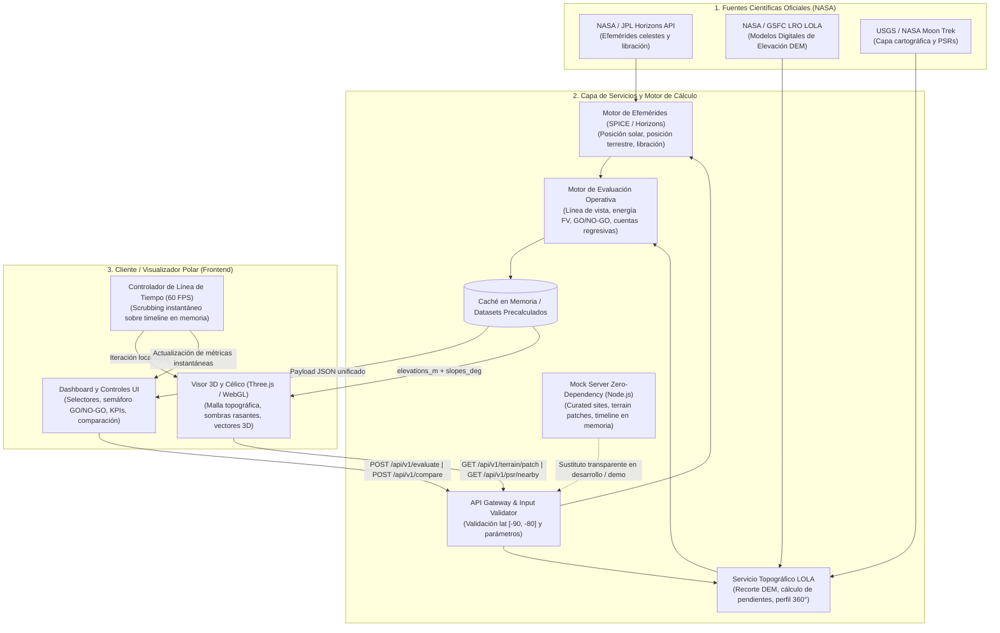

# 2. Arquitectura

Estructura global del sistema, responsabilidades por componente, flujo de datos de extremo a extremo y fundamentos de ingeniería que sustentan el diseño.



---

## Piezas y responsabilidades

| Pieza | Responsable | Qué hace |
| --- | --- | --- |
| **Dashboard y Controles UI** | Frontend (`web/ui`) | Captura las coordenadas de entrada o selección de sitios curados, renderiza tarjetas KPI, estado GO/NO-GO con desglose de justificaciones, tabla comparativa de escenarios y alertas operativas. |
| **Visor 3D Topográfico y Célico** | Frontend (`web/3d-viewer`) | Construye la geometría de la superficie lunar en Three.js a partir del array plano `elevations_m`, colorea por mapa de pendientes (`slopes_deg`), posiciona luces direccionales según `sun_vector_3d` y proyecta sombras dinámicas y conos de comunicación hacia `earth_vector_3d`. |
| **Controlador de Línea de Tiempo** | Frontend (`web/timeline`) | Permite el desplazamiento temporal (*scrubbing*) continuo a 60 FPS leyendo el array `timeline[]` prealmacenado en memoria, sincronizando la orientación solar, terrestre y los contadores en tiempo real sin peticiones HTTP adicionales. |
| **API Gateway & Validador** | Backend / Mock (`api/gateway`) | Enruta peticiones REST (`/api/v1/*`), comprueba restricciones geográficas (latitud en rango polar estricto `-90.0°` a `-80.0°`), sanitiza parámetros temporales y devuelve códigos de error estructurados con encabezados estándar. |
| **Servicio Topográfico LOLA** | Backend (`services/terrain`) | Extrae parches de elevación del DEM polar LOLA a resoluciones configurables (p. ej. 128x128 sobre 12 km x 12 km), genera vectores de pendiente y calcula la silueta azimutal de elevación del horizonte de 0° a 359° alrededor del sitio. |
| **Motor de Efemérides Celestes** | Backend (`services/ephemeris`) | Consulta y procesa datos vectoriales de NASA JPL Horizons o kernels SPICE para determinar la elevación y acimut del Sol y la Tierra desde el marco topocéntrico lunar, incorporando las oscilaciones por libración óptica y física. |
| **Motor de Evaluación Operativa** | Backend (`services/evaluator`) | Cruza la elevación celeste con la elevación del horizonte local para resolver oclusión geométrica (visibilidad solar y enlace DTE directo), calcula generación fotovoltaica relativa y estima tiempos hacia el próximo ocaso (*sunset*) y ocultamiento terrestre (*earthset*). |
| **Servidor Mock Zero-Dependency** | Herramienta (`mock/server.js`) | Servidor HTTP ligero basado exclusivamente en módulos nativos de Node.js (`http`, `fs`, `path`, `url`) que emula la totalidad del contrato `v1.0` con datos realistas para desarrollo desacoplado, tests automatizados y presentaciones sin conexión a internet. |

---

## Flujo de datos

El ciclo de procesamiento de una evaluación de aterrizaje opera según la siguiente secuencia:

```text
[Cliente: Selección] 
       │  (lat, lon, start_utc, duration_days, step_minutes)
       ▼
1. Validación de Entrada
       │  ¿Latitud entre -90.0° y -80.0°? ¿Fecha dentro de ventana soportada?
       │  ├── NO  ──▶ Retorna ERR_INVALID_COORDINATES (HTTP 422) o ERR_DATE_OUT_OF_RANGE (HTTP 422)
       └── SÍ  ──▶ Continúa procesamiento
       ▼
2. Extracción Topográfica y Perfil de Horizonte (LOLA DEM)
       │  - Obtención de elevación base y pendientes locales.
       │  - Trazado de rayos radiales (0° a 359° acimut) sobre el DEM polar.
       │  - Vector resultante: horizon_profile = [{ az: 0, el: 0.85° }, ..., { az: 359, el: 1.10° }]
       ▼
3. Cálculo de Efemérides Celestes Paso a Paso (JPL Horizons / SPICE)
       │  - Para cada paso temporal t_i (desde start_utc cada step_minutes):
       │    * Posición solar: sun_az_deg, sun_el_deg, sun_vector_3d
       │    * Posición terrestre: earth_az_deg, earth_el_deg, earth_vector_3d (con libración)
       ▼
4. Análisis de Línea de Vista (Line of Sight - LOS)
       │  - Sol visible si: sun_el_deg > horizon_profile[round(sun_az_deg)].horizon_el_deg
       │  - Tierra visible (DTE) si: earth_el_deg > horizon_profile[round(earth_az_deg)].horizon_el_deg
       │  - Factor de potencia instantáneo: max(0, sin(sun_el_deg)) * panel_efficiency * panel_area_m2
       ▼
5. Agregación de Métricas, Cuentas Regresivas y Veredicto
       │  - sun_visible_pct, earth_visible_pct, max_continuous_sun_hours, max_continuous_dte_hours.
       │  - Detección del primer evento de puesta solar (next_sunset_utc) y terrestre (next_earthset_utc).
       │  - Regla de decisión: GO si pendiente <= 10°, sol >= 70% y DTE >= 50%; si no, NO-GO con motivos.
       ▼
6. Despacho de Payload Unificado
       │  - JSON consolidado con site, summary, horizon_profile y timeline[] completo.
       ▼
[Cliente: Renderizado 3D y Scrubbing en Memoria]
```

---

## Por qué esta forma

Las decisiones arquitectónicas del sistema responden a restricciones físicas del polo sur lunar, demandas de rendimiento interactivo y confiabilidad operativa durante presentaciones y evaluaciones:

1. **Precalcular perfiles de elevación de horizonte (360°) en el servidor:**
   * *Problema:* Determinar si el Sol o la Tierra están ocultos detrás de una montaña a 25 km requiere proyectar rayos sobre millones de triángulos de un DEM a alta resolución. Ejecutar esto en el navegador web del cliente sobrecargaría la GPU/CPU y provocaría congelamientos en la interfaz.
   * *Solución:* El backend proyecta los 360 rayos radiales una sola vez por sitio consultado y genera un arreglo compacto de 360 puntos. Con este perfil, la verificación de visibilidad para cualquier paso de tiempo se reduce a una comparación aritmética elemental en tiempo constante $O(1)$:
     $$\text{visible} = \theta_{\text{astro}} > \theta_{\text{horizonte}}(\phi_{\text{astro}})$$

2. **Entrega de vectores direccionales tridimensionales (`sun_vector_3d`, `earth_vector_3d`):**
   * *Problema:* Las coordenadas celestes naturales vienen en ascensión recta/declinación o acimut/elevación en marcos selenocéntricos lunares (IAU Moon). Transformar estos ángulos a un espacio local euclidiano de escena 3D en el cliente introduce riesgo de discrepancias matemáticas y cálculos trigonométricos redundantes por cada frame.
   * *Solución:* El servicio resuelve la orientación de los ejes locales ($+X=\text{Este}$, $+Y=\text{Arriba}$, $-Z=\text{Norte}$) y entrega vectores cartesianos unitarios directamente utilizables por motores gráficos como Three.js para posicionar luces `DirectionalLight` y cámaras de monitoreo.

3. **Líneas de tiempo completas en memoria (`timeline[]`):**
   * *Problema:* Hacer peticiones HTTP al servidor cada vez que el usuario mueve el control deslizante temporal generaría demoras perceptibles, parpadeos de sombras y una experiencia de usuario frustrante e inaceptable para análisis dinámico.
   * *Solución:* Una simulación típica de 14 días con intervalos de 60 minutos contiene 336 puntos de datos. Un payload JSON con 336 elementos estructurados pesa menos de 100 KB gzippeado. Al transferirse completo en la respuesta inicial de `POST /api/v1/evaluate`, el cliente ejecuta *scrubbing* fluido a 60 FPS sin emitir una sola llamada adicional a la red.

4. **Servidor Mock autónomo con cero dependencias externas:**
   * *Problema:* Las conferencias, hackathons presenciales y salas de evaluación del NASA Space Apps suelen contar con conexiones a internet inestables, proxies corporativos o restricciones de firewall que bloquean accesos directos a la API de JPL Horizons o descargas de kernels SPICE de varios gigabytes.
   * *Solución:* El componente `mock/server.js` está construido únicamente con la biblioteca estándar de Node.js (`http`, `fs`, `path`, `url`), sin requerir `npm install` ni paquetes externos. Permite clonar el repositorio, ejecutar `node mock/server.js` e iniciar el visor inmediatamente con datos científicos fidedignos de sitios polares reales.
